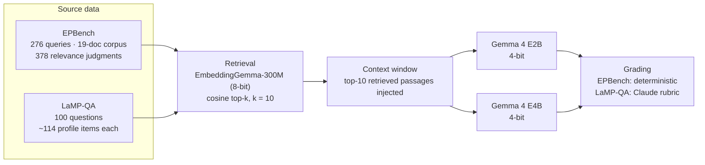
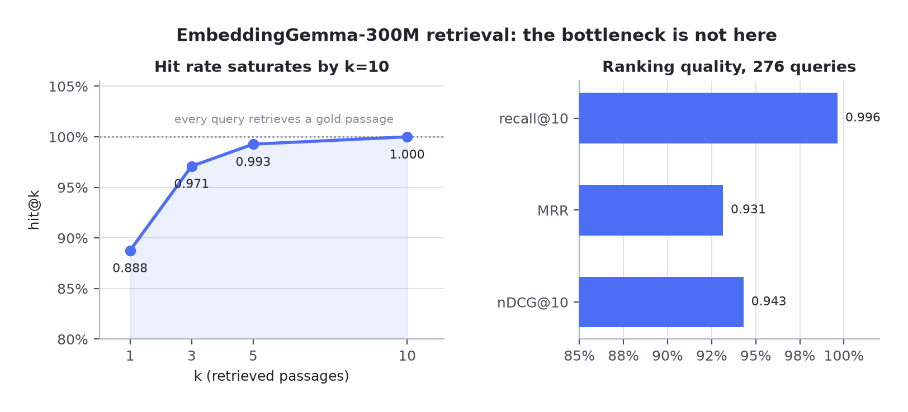
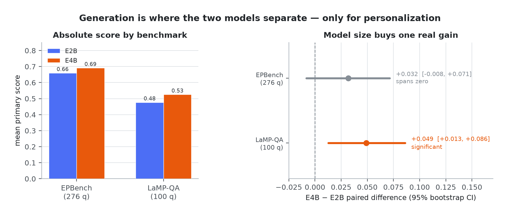
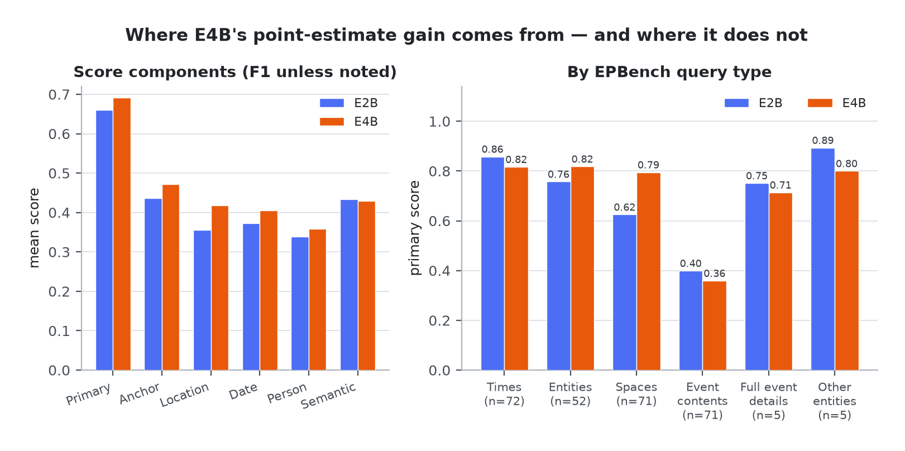
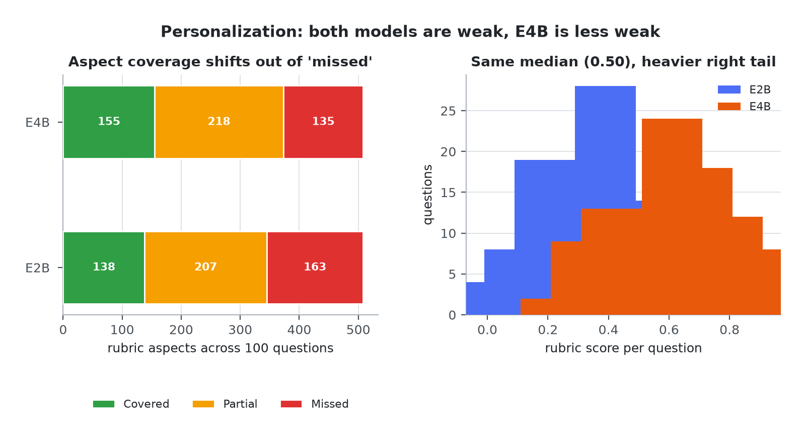
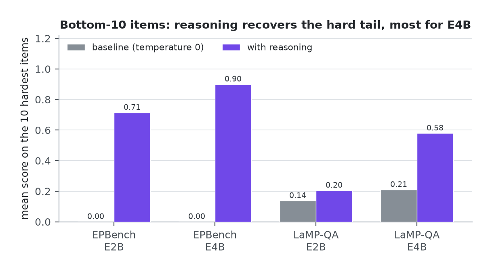
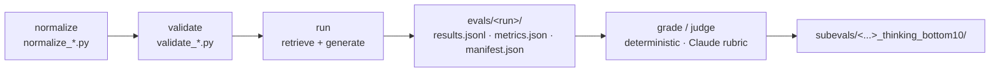

# Retrieved Episodic and Personalized Semantic Memory in Small Local Language Models

Benchmark-first evaluation for CS 6795 (Cognitive Science · Georgia Institute of Technology · Summer 2026).
Michael Navazhylau — mnavazhylau3@gatech.edu

**Final report:** [`paper/MichaelNavazhylau_FinalReport.pdf`](paper/MichaelNavazhylau_FinalReport.pdf) — 7 pages. The README below is the short version; the report carries the full argument, method, and discussion.

The question is narrow on purpose. Once episodic event memory and personalized
profile memory are retrieved and placed in a small local model's context, where
does answer quality break down — in retrieval or in generation — and how much
does model size change it?

Memory is not varied as a condition here. It is always retrieved and always
supplied. So this repo does not measure "memory vs. no memory." It measures where
the pipeline fails *after* the right memory is already in context.

**The pipeline under test.** One embedder, one k, two generators. Because the
retrieval half is held fixed, any difference downstream is attributable to
generation.



## Bottom line

Retrieval is not the bottleneck. A 300M embedder puts the right memory in the
context window almost every time — **hit@10 = 1.000** over 276 EPBench queries —
so any difference in answer quality comes from generation, not from what was
retrieved.

The larger generator (Gemma 4 **E4B** vs **E2B**) buys exactly one gain that
survives a significance test: **personalized answering** (LaMP-QA rubric **0.526
vs 0.477**, paired 95% CI excludes zero). On episodic recall the larger model is
higher on the point estimate (**0.691 vs 0.660**) but the paired difference sits
inside sampling noise. The difference is this: model size helps where the task is
to synthesize a user profile into an answer, not where it is to reproduce the
bound details of one event. Personalization is also where both models are weakest
in absolute terms, so the payoff and the frontier are the same place.

## Setup

| Piece | Choice | Role |
|---|---|---|
| Episodic benchmark | **EPBench** (via LMEB) — 276 queries, 19-doc corpus, 378 relevance judgments, 6 query types | Recall specific past events; graded **deterministically** |
| Semantic benchmark | **LaMP-QA** — 100-question sample, ~114 profile items per question | Personalized long-form QA; graded by a **Claude-CLI rubric** |
| Retriever | **EmbeddingGemma-300M**, 8-bit GGUF | Embeds queries and candidates; cosine top-k |
| Generators | **Gemma 4 E2B and E4B**, 4-bit GGUF, 128K context, temperature 0 | The primary comparison is model size |
| Serving | `llama.cpp` — embedding server on `:8082`, chat server on `:8081` | Retrieval and generation stay decoupled |

Two axes are kept separate throughout: **retrieval vs. generation**, and **E2B vs.
E4B**. Retrieval uses one embedder and a fixed k, so it is identical no matter
which generator runs. That is what lets any downstream difference be attributed to
generation.

## Results

### Retrieval is near-ceiling

Over the 276 EPBench queries, with the shared embedder and top-k, retrieval
saturates. These numbers are identical for the E2B and E4B pipelines — same
embedder, same k, same data.

| hit@1 | hit@3 | hit@5 | **hit@10** | recall@10 | MRR | nDCG@10 |
|---|---|---|---|---|---|---|
| 0.888 | 0.971 | 0.993 | **1.000** | 0.996 | 0.931 | 0.943 |



*Figure 1 — Retrieval quality. The ranking metrics on the right are what would
still be low if retrieval were the weak stage; they are not. Every claim that
follows is about the gap above the context window, not inside retrieval.*

The correct memory is almost always in the retrieved context. This one result
organizes the rest: what remains is a generation question.

### Generation: the model-size effect is real only for personalization

Paired 95% bootstrap CIs (E4B − E2B, 20,000 resamples) are computed over the
committed per-item score files (`deterministic_grade_scores.csv`,
`claude_rubric_v3_scores.csv`).

| Benchmark | Grading | E2B | E4B | Paired diff | 95% CI | Distinguishable? |
|---|---|---|---|---|---|---|
| EPBench (episodic), 276 q | deterministic | 0.660 | **0.691** | +0.032 | [−0.008, +0.071] | No — CI spans 0 |
| LaMP-QA (personalized), 100 q | Claude rubric | 0.477 | **0.526** | +0.049 | [+0.013, +0.086] | Yes — p ≈ 0.009 |



*Figure 2 — The whole headline in one picture. Left: absolute scores, which look
like a uniform E4B win. Right: the same data as paired differences. Only the
LaMP-QA interval clears zero; the EPBench interval straddles it.*

On EPBench the two models are not statistically distinguishable on 276 queries:
E4B wins 35%, ties 39%, loses 26%. The point-estimate gain concentrates in
concrete, entity-like fields; the semantic-cosine term does not move.

| EPBench component | E2B | E4B |
|---|---|---|
| Primary score | 0.660 | 0.691 |
| Anchor F1 | 0.437 | 0.472 |
| Location F1 | 0.356 | 0.418 |
| Date F1 | 0.372 | 0.406 |
| Person F1 | 0.338 | 0.358 |
| Semantic cosine | 0.434 | 0.430 |

By query type, both models are strongest on Times and Entities and weakest on
Event contents — the one category where the larger model does not help, because
open-ended event descriptions resist an extraction-based grader. E4B's clearest
gain is Spaces (0.625 → 0.795).

| Query type | n | E2B | E4B |
|---|---|---|---|
| Times | 72 | 0.858 | 0.817 |
| Entities | 52 | 0.757 | 0.818 |
| Spaces | 71 | 0.625 | 0.795 |
| Event contents | 71 | 0.399 | 0.359 |
| Full event details | 5 | 0.751 | 0.714 |
| Other entities | 5 | 0.893 | 0.800 |

*(Full event details and Other entities are 5 queries each — read them as
directional, not stable.)*



*Figure 3 — Where the EPBench point estimate comes from. The component panel moves
almost entirely in the entity-like fields; the query-type panel shows the gain
concentrated in Spaces while Event contents moves the wrong way.*

On LaMP-QA the paired test — which removes between-question variance — is what
establishes the effect. The per-item median is 0.500 for both models, so the
improvement is a distributional shift, not a change in the typical case: E4B moves
aspects out of "missed" and into coverage.

| Aspect bucket | E2B | E4B |
|---|---|---|
| Covered | 138 | 155 |
| Partial | 207 | 218 |
| Missed | 163 | 135 |



*Figure 4 — Why the paired test sees what the median does not. The median question
scores 0.50 for both models; what changes is the mass in the upper tail and the
count of entirely missed aspects.*

Neither small model approaches full aspect coverage. Personalization is hard for
both.

### Reasoning recovers the hard tail — mostly for the larger model

Re-running the ten lowest-scoring items per benchmark with the model's reasoning
("thinking") mode enabled recovers them, most for E4B.

| Benchmark | Bottom-10 baseline (E2B / E4B) | With reasoning (E2B / E4B) |
|---|---|---|
| EPBench | 0.000 / 0.000 | 0.715 / **0.900** |
| LaMP-QA | 0.138 / 0.210 | 0.205 / **0.579** (+0.369 for E4B) |



*Figure 5 — Hard-tail recovery. Every EPBench bottom-10 item scored 0.000 without
reasoning, so the EPBench bars are the full lift; LaMP-QA has a nonzero floor, so
read those two pairs as deltas.*

Two caveats bound this. Because the base run is deterministic at temperature 0, a
no-reasoning re-run reproduces the baseline exactly, so the lift is attributable to
reasoning rather than resampling noise. But the items were selected as the hardest,
so the magnitude does not generalize — and the lift cannot be cleanly separated
from the fact that the bottom items had the most room to improve. This is targeted
error analysis, not a thinking condition over the full distribution.

## What this says

Read through the pipeline as a cognitive model: stored records are the
representations, embedding and retrieval are the associative access, the context
window is a working-memory buffer, and the answer is the behavior being scored.
The results place the bottleneck in the second stage. Associative retrieval is
saturated at 300M parameters, so the representations the model needs are already in
the buffer. What limits answer quality is the procedural step that reads those
representations and composes an answer — and that step is where model size and
reasoning make their difference.

The practical implication is that "add more memory" is the wrong lever for a small
local assistant. The relevant items are already retrieved. The productive work is
in the generator that consumes them, and specifically in personalization, where
scores sit near 0.5 and where the extra parameters of E4B produce the one
improvement that holds up.

## Limitations

- The benchmarks are proxies for the motivating productivity setting, not real user
  tasks. No human participants, no interactive assistant.
- Samples are modest (276 EPBench queries, 100 LaMP-QA questions) and the size
  effects are small. On EPBench the paired difference is not significant, so treat
  that comparison as suggestive.
- All models are quantized (4-bit generators, 8-bit embedder), which likely
  depresses absolute scores.
- LaMP-QA is graded by an LLM judge — an approximation with known position,
  verbosity, and self-enhancement biases, reduced with a fixed rubric and
  temperature 0 but not removed. The deterministic EPBench score is the more
  trustworthy headline because it does not depend on a judge at all.
- There is **no** none/episodic/semantic/combined memory-condition ablation. The two
  axes actually varied are model size and reasoning on the hard tail. Every claim is
  scoped to those two axes.

## Repository layout

Code, evaluation artifacts, and the final report. The pitch, poster, paper notes,
and Zotero tooling are not part of this repository.

```
src/data-normalization/   normalize_*.py, validate_*.py, sample_processed_datasets.py
src/evals/                run_*.py (retrieve + generate), grade_epbench_deterministic.py,
                          judge_lampqa_rubric_claude_cli.py, judge_lampqa_claude_cli.py, score_*.py
data/raw/                 source-dataset READMEs and dataset cards only; the LFS payloads
                          (91 MB each) are not committed — see data/raw/README.md for scope
data/processed/           normalized corpus, queries/qrels, questions, sampled sets
evals/<run>/              results.jsonl, metrics.json, manifest.json, *_scores.*,
                          subevals/<...>_thinking_bottom10/ (reasoning sub-eval)
docs/figures/             make_figures.py + the PNGs rendered in this README
paper/                    MichaelNavazhylau_FinalReport.pdf (7 pages)
pyproject.toml, uv.lock   uv-managed environment (Python 3.13)
```

The pipeline is a set of standalone scripts wired append-only:



**normalize → validate → run (retrieve + generate) → grade / judge.**

Runs are committed as durable artifacts. Each run directory carries its own
`manifest.json`, `metrics.json`, `results.jsonl`, and score files together.

### Reading the artifacts (two things that will bite you)

- **`manifest.json` is authoritative for the model.** The `run_*_e2b_*.py` scripts
  are reused for E4B by changing the chat model and server URL. Do not infer the
  model from the filename.
- **LaMP-QA stores every generated answer under `e2b_answer`, even for E4B runs**
  (shared runner kept the field name). Read the model from `manifest.json`, not the
  field.

The `embedding_cache.jsonl` files are regenerable retrieval caches and are
`.gitignore`d — the source runs regenerate them, and two of them exceeded the
remote's file-size limit.

## Reproducing

Full evals are already complete and committed, so nothing here requires a long run.
Keep the dependency cache repo-local:

```bash
UV_CACHE_DIR=.uv-cache uv sync
UV_CACHE_DIR=.uv-cache uv run python -m py_compile src/evals/*.py src/data-normalization/*.py   # smoke check
```

To re-run a stage you need two local `llama-server` instances — the embedder on
`:8082` and a chat model on `:8081` — then invoke the matching `src/evals/run_*.py`
against them. There is no test suite; `py_compile` is the smoke check and `main.py`
is a stub.

To regenerate the figures in this README from the committed score files:

```bash
UV_CACHE_DIR=.uv-cache uv run python docs/figures/make_figures.py
```

The script reads every number out of `evals/` at run time (including the paired
bootstrap CIs, with a fixed seed), so the figures cannot drift away from the
committed scores.

## A note on the commit history

The commits were squashed and reordered by project phase, not left in the order the
work actually happened. The history reads as the thought process — scaffold, then
data normalization, then the retrieval/generation runners, then run artifacts, then
graders and judges, then the bottom-10 reasoning sub-evals — so the phase commits
map onto the sections above rather than to the day-to-day sequence. A final commit
adds the figures and this README pass.
